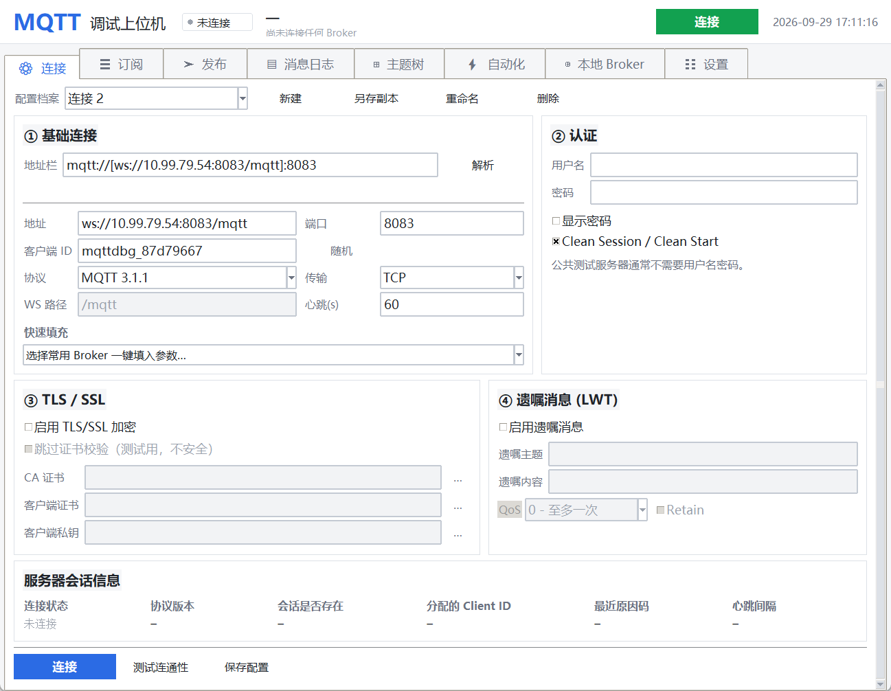

# MQTT 全功能调试上位机

一个用纯 Python + Tkinter 写的 MQTT 桌面调试工具，界面参考了 MQTTX / MQTT Explorer 的使用习惯，
但没有任何前端框架依赖 —— 图形界面用系统自带的 tkinter，协议部分用 paho-mqtt。



---

## 一、快速开始

### 方式 1：直接运行（推荐）

```bash
# 1. 安装唯一依赖
pip install paho-mqtt

# 2. 启动
python mqtt_debugger.py
```

Windows 用户也可以直接双击 **`启动.bat`**，脚本会自动检查环境并在缺依赖时安装。

### 方式 2：打包成 exe（给没装 Python 的机器用）

```bash
python build_exe.py          # 生成单文件 exe
python build_exe.py --onedir # 生成文件夹版（启动更快）
```

产物在 `dist/` 目录，双击即可运行，目标机器不需要装 Python。

### 环境要求

| 项目 | 要求 |
|---|---|
| Python | 3.8 及以上 |
| tkinter | Python 自带（Windows 安装时勾选 `tcl/tk and IDLE`） |
| paho-mqtt | 1.6.1 及以上（2.x 会自动使用新版回调 API） |

Linux 上如果缺 tkinter：`sudo apt install python3-tk`
macOS：`brew install python-tk`

---

## 二、功能总览

程序有 8 个功能页，覆盖 MQTT 调试的完整链路。

**既能当客户端，也能当服务端** —— 内置了一个纯 Python 实现的 MQTT Broker，
可以把本机变成一台供局域网内其他设备（单片机、树莓派、同事的电脑）连接的
调试服务器，不需要另外装 mosquitto。

### 1. 连接页

| 能力 | 说明 |
|---|---|
| 地址栏 | **可直接粘贴完整 URL**（`ws://10.0.0.5:8083/mqtt`、`mqtts://host:8883`），回车自动拆分到下方各项 |
| 协议版本 | MQTT 3.1 / 3.1.1 / 5.0 |
| 传输方式 | TCP、WebSocket（可自定义路径，默认 `/mqtt`） |
| TLS/SSL | CA 证书、双向认证（客户端证书 + 私钥）、可跳过校验 |
| 认证 | 用户名 / 密码 |
| 遗嘱消息 | 主题、内容、QoS、Retain 全套配置 |
| 会话控制 | Clean Session / Clean Start |
| 自动重连 | 可设重连间隔与最大次数（0 = 无限） |
| 配置档案 | 多套连接参数并存，一键切换 / 复制 / 重命名 / 删除 |
| 快速填充 | 内置 EMQX、HiveMQ、Mosquitto 公共测试服与本地 Broker |
| 连通性测试 | 后台线程做 TCP/TLS 握手，不污染当前会话 |

> **关于「地址」框**：这里只填主机名或 IP，**不要带 `ws://` 前缀和 `/mqtt` 路径**。
> 带了协议前缀的话 paho 会把它当域名去解析，失败后静默无限重试，界面会一直停在
> 「连接中…」而不报错 —— 这是最容易踩的坑。想省事就直接用上面的「地址栏」粘贴完整
> 地址回车，程序会自动拆分并填入端口、传输方式、TLS、WS 路径。
> 主机框里一旦出现 `://`、`/` 或 `:端口`，下方会立刻给出黄色修正提示。

内置的公共测试服务器可以直接拿来练手：

| 名称 | 地址 |
|---|---|
| EMQX 公共测试服 | `broker.emqx.io:1883` / `:8883` (TLS) |
| HiveMQ 公共测试服 | `broker.hivemq.com:1883` |
| Mosquitto 官方测试服 | `test.mosquitto.org:1883` / `:8883` (TLS) |
| 本地 Broker | `127.0.0.1:1883` / `:8083` (WS) |

### 2. 订阅页

- 支持 `+`（单层通配）与 `#`（多层通配），输入时即时校验语法
- 每条订阅可单独设 QoS、备注名，并显示已收到条数
- 快捷订阅：`#`、`sensor/#`、`device/+/status`、`$SYS/#`、共享订阅 `$share/g1/demo/#`
- 未连接时也能先把订阅列表配好，连上后自动生效
- 内置通配符速查表，不用去翻文档

### 3. 发布页

- **四种编码**：文本、JSON（自动校验与压缩）、HEX、Base64
- **QoS 0/1/2** + **Retain** 保留消息
- **内容模板**：内置常用 JSON 模板，可保存自己的常用报文
- **占位符变量**：`{ts}` `{time}` `{date}` `{iso}` `{uuid}` `{rand}`，发布时自动替换
- **周期发布**：按固定间隔循环发送，支持 5 种值时变模式
  - 文本（原样发送）/ 自增 / JSON 自增 / 随机数 / 时间戳
- **单次发布**：不建立会话，直接用配置连一次、发一条、断开。适合验证 Broker 可达性
- 发布主题历史下拉，`Ctrl+Enter` 快捷发布

### 4. 消息日志页

- 实时列表：时间（毫秒精度）、方向、主题、QoS、Retain、字节数、内容
- **多条件过滤**：主题（支持 `*` 通配）、内容包含（支持正则）、方向、QoS、仅 Retain
- **关键字高亮**：命中的行整行标黄，详情里也会高亮
- 显示范围可限制为最近 100 / 500 / 1000 条
- **暂停**按钮：抓包分析时冻结视图，继续后自动补上
- **详情面板**：JSON 自动格式化，右侧显示完整元信息（MID、DUP、HEX 等）
- **实时流速曲线**：Canvas 手绘的每秒收发消息数曲线
- **导出**：CSV（带 BOM，Excel 直接打开不乱码）、TXT、JSON、JSONL
- 右键菜单：复制主题 / 复制内容 / 载入到发布页 / 用该主题过滤
- 双击任意一条消息 → 直接载入发布页，方便快速回复

### 5. 主题树页

把收到的消息按 `/` 层级聚合成一棵可折叠的树，非常适合观察一整棵设备树的实时状态。

- 每个节点显示：消息条数、最后 QoS、最后更新时间、最后一条内容
- 3 秒内更新的节点显示为绿色
- 保留消息（Retain）节点用橙色区分
- 过滤框支持按路径搜索，命中节点会自动保留祖先链
- 选中节点后可一键「订阅该主题」或「载入发布页」
- 实时刷新可关闭，方便静态分析

### 6. 自动化页

用**规则**代替脚本，不需要写代码：

> 收到 `[主题过滤器]` 且 `[匹配方式]` `[匹配内容]` 的消息时 → `[动作]`

- **匹配方式**：包含 / 完全等于 / 以…开头 / 以…结尾 / 不包含 / 正则表达式 / 任意内容
- **动作**：发布到指定主题 / 回复到原主题 / 仅记录
- **占位符**：`{topic}` `{payload}` `{match}` `{topic1}` `{topic2}` `{time}` `{date}` `{ts}`
- 支持延迟发送（毫秒）、QoS、Retain 设置
- **「测试匹配」按钮**：给一条示例消息，立刻看到是否会触发、回复成什么样
- 触发记录可查看、清空、导出

**典型用法**：收到 `device/+/status` 且内容等于 `on` → 回复到 `{topic}/ack`，内容 `{"ack": 1, "ts": "{ts}"}`

> 为什么不做成能写 Python 脚本？因为 `exec` 用户脚本等于把任意代码执行权交出去。
> 规则式设计覆盖了绝大多数调试场景，而且更安全。

### 7. 本地 Broker 页（本机当服务端）

把本机变成一个 MQTT Broker，供局域网内的其他主机连接调试。

| 能力 | 说明 |
|---|---|
| 一键启停 | 启动 / 停止，状态胶囊实时反馈 |
| 监听地址 | `0.0.0.0`（局域网可连）或 `127.0.0.1`（仅本机） |
| 监听端口 | 默认 1884，避开常被 mosquitto 占用的 1883 |
| **WebSocket 传输** | **可同时再监听一个 WS 端口**（默认 8083，路径 `/mqtt`），供浏览器 / 小程序 / 前端连接 |
| 访问认证 | 用户名 / 密码，错误凭据返回 CONNACK 0x04 |
| IP 访问控制 | 白名单 / 黑名单，支持 `192.168.1.0/24` 网段写法 |
| 协议行为 | 最大 QoS（超出自动降级）、Retain 开关、最大连接数 |
| 在线客户端 | 标识、来源地址、协议、心跳、Clean、订阅数、在线时长 |
| 订阅表 | 全局 「主题过滤器 → 订阅者 → QoS」 一览 |
| 保留消息 | 已缓存的 Retain 主题，可一键清空 |
| 实时日志 | 连接 / 订阅 / 路由 / 拒绝 逐条带时间戳，按级别着色 |
| 运行统计 | 累计连接、当前在线、被拒绝、收发消息数与流量 |

**WebSocket 支持**：勾选「同时监听 WebSocket 端口」后，Broker 会在 TCP 端口之外
再开一个 WS 端口，**两个入口共用同一套会话、订阅表与保留消息** —— 即一个用 TCP
连的客户端和一个用 WS 连的客户端可以互相收发消息。实现的是 RFC 6455 子集：
HTTP/1.1 Upgrade 握手、`Sec-WebSocket-Accept` 校验、`mqtt` 子协议协商、
二进制帧编解码、掩码处理、分片重组、Ping/Pong、Close 帧。
路径不对会回 `404`，不是 WebSocket 请求会回 `400`，都带中文说明，方便浏览器直接自检。

> 为什么需要它：EMQX 等主流 Broker 默认就同时开放 `1883`（TCP）和 `8083`（WebSocket），
> 很多前端（网页、小程序、微信云函数）只能用 WebSocket 连 MQTT。
> 内置 Broker 现在也具备了同样的双入口能力。

**连接信息面板**会自动列出本机的对外 IP 和端口（TCP 与 WS 各一条，可直接粘进连接页的地址栏），
也可以一键复制。

**「让本机连上自己」** 按钮会把连接页的目标切到 `127.0.0.1:<端口>` 并立即连接，
单机就能完成「发布 → Broker 路由 → 订阅收到」的闭环自测。

协议支持范围：MQTT 3.1 / 3.1.1，QoS 0/1/2（含完整的 PUBREC/PUBREL/PUBCOMP 流程），
通配符订阅（`+` / `#`，含 `$` 主题隔离规则）、保留消息、遗嘱消息、会话保持
（`clean_session=False` 断线后恢复订阅）、Keep Alive 超时判定、重复 client_id 抢占。

有意不支持：MQTT 5.0、共享订阅负载均衡、持久化存储、`$SYS` 主题发布、桥接。

> 为什么自己实现而不依赖现成的 Broker？因为上位机要能**独立**跑在一台机器上做联调，
> 不能要求用户额外装 mosquitto。协议解析只依赖 `struct`，零第三方依赖。

### 8. 设置页

- 界面偏好：日志最大行数、退出时保存日志、启动时恢复日志、自动保存配置、退出确认
- 配置管理：导出 / 导入 / 重置，一键打开配置目录
- 运行环境自检：Python 版本、paho 版本、Tk 版本、回调 API 模式

---

## 三、界面与交互细节

**全局快捷键**

| 快捷键 | 作用 |
|---|---|
| `Ctrl+1` ~ `Ctrl+8` | 切换功能页 |
| `Ctrl+Enter` | 发布消息 |
| `F5` | 连接 / 断开 |
| `Ctrl+S` | 保存配置 |
| `Ctrl+L` | 清空日志 |
| `Ctrl+K` | 清空过滤条件 |
| `Delete` | 订阅页删除选中订阅 |

**状态指示**

- 顶栏胶囊显示 未连接 / 连接中 / 已连接 / 重连中 / 连接失败，配对应颜色
- 已连接时显示在线时长
- 底栏实时显示 `RX / TX` 计数、累计流量、重连次数
- 出错时消息会以红色系统条目同步到日志页

**配置持久化**

- 默认目录：`~/.mqtt_debugger/`（可用环境变量 `MQTT_DEBUGGER_HOME` 覆盖）
- `config.json` 保存连接档案、订阅、规则、模板、窗口位置
- `history.json` 保存消息日志（默认开启，可在设置里关闭）
- 配置损坏时会自动回退到默认值，不会阻塞启动

---

## 四、项目结构

```
MQTT调试上位机/
├── mqtt_debugger.py          启动入口（含环境自检）
├── 启动.bat                  Windows 一键启动
├── build_exe.py              PyInstaller 打包脚本
├── requirements.txt
├── mqtt_client/
│   ├── __init__.py
│   ├── config.py             配置数据结构与 JSON 持久化
│   ├── core.py               MQTT 服务层（paho 封装）+ 主题工具
│   ├── script.py             规则引擎 + 周期发布器
│   ├── broker.py             内置 MQTT Broker 服务端（含 WebSocket 传输，零第三方依赖）
│   └── ui/
│       ├── app.py            主窗口、事件循环、快捷键
│       ├── theme.py          配色、字体、ttk 样式
│       ├── widgets.py        可复用组件（卡片、状态胶囊、Toast、提示气泡…）
│       ├── connection.py     连接页
│       ├── subscribe.py      订阅页
│       ├── publish.py        发布页
│       ├── log.py            消息日志页
│       ├── tree.py           主题树页
│       ├── automation.py     自动化页
│       ├── broker_panel.py   本地 Broker 页
│       └── settings.py       设置页
└── tools/
    ├── test_core.py          核心逻辑单元测试（169 项）
    ├── test_broker.py        Broker 集成测试（54 项，真实 paho 客户端驱动）
    ├── test_broker_ws.py     Broker WebSocket 传输测试（63 项）
    ├── smoke_test.py         界面冒烟测试（构建全部页面、跑 Broker 联调、截图）
    └── shot_*.png            各页面截图
```

---

## 五、架构要点

### 线程模型

这是这类工具最容易翻车的地方，所以单独说明：

```
paho 网络线程               Tkinter 主线程
     │                            │
     ├─ 回调（on_connect/...）     │
     │      │                     │
     │      ▼                     │
     └─> queue.Queue  ──after(40ms)──>  更新控件
                                  │
     控件回调 ──> MQTTService 的线程安全方法 ──> paho
```

- paho 的回调**绝不**直接操作控件，一律打包成 `Event` 投进队列
- 主线程用 `after(40, ...)` 批量消费事件，单次最多处理 400 条，避免卡界面
- 界面上的操作通过 `MQTTService` 的加锁方法下发，两边从不直接互调
- 单个回调抛异常不会掀翻程序，会被捕获并作为错误日志显示

### 兼容性

- 自动探测 paho 版本：2.x 用 `CallbackAPIVersion.VERSION2`，1.x 回退到旧签名
- MQTT 5.0 的原因码有完整的中文映射表（连接被拒时能看懂到底为什么）
- 载荷解码会尝试 UTF-8 → GBK，都不行才回退到 Base64

### 内置 Broker 的线程模型

```
accept 线程 (TCP)  ┐
accept 线程 (WS)   ┼─> 每个客户端一个 ClientSession 线程
                        │
                        └─> 全局 _lock (RLock) 保护 clients / _subs / _retained
```

- 每连接一线程：调试场景并发量小（几十个连接），不值得为可扩展性引入事件循环
- 所有共享状态用同一把可重入锁保护，避免出现死锁
- 事件同样走 `queue.Queue` 投给界面，与客户端侧保持一致的线程纪律
- 单个连接的异常被限制在该连接线程内，不会拖垮整个 Broker
- `SO_EXCLUSIVEADDRUSE`（Windows）保证端口独占，避免"看起来启动成功但收不到连接"
- **TCP 与 WebSocket 共用同一份 MQTT 报文处理逻辑**：`ClientSession` 只负责协议语义，
  收发字节这层按 `transport` 分流到裸 socket 或 WS 帧编解码器，两条路径的行为完全一致

**WebSocket 传输层**（`broker.py` 内的 `parse_ws_handshake` / `encode_ws_frame` / `decode_ws_frame`）：

- 握手：校验 `Upgrade` / `Connection` / `Sec-WebSocket-Key`（必须是 16 字节 Base64），
  按 RFC 6455 计算 `Sec-WebSocket-Accept`（注意 GUID 是 36 字符，末尾没有多余的 D），
  协商 `mqtt` 子协议
- 帧：支持 7 / 16 / 64 位三种长度字段、客户端掩码、分片（continuation）、
  Ping / Pong / Close 控制帧
- **按字节流语义收数据**：MQTT 报文可能被拆进多个 WS 帧，也可能多条报文挤在一个帧里，
  所以接收侧维护了一个偏移缓冲区，逐字节取用而不假设"一帧 = 一个报文"
- 握手失败时回普通 HTTP 响应（`400` / `404`）并附中文说明，便于浏览器或 `curl` 直接自检

---

## 六、常见问题

**其他主机连不上我开的 Broker？**

按顺序排查：

1. 确认「监听地址」是 `0.0.0.0` 而不是 `127.0.0.1`（后者只接受本机连接）
2. Windows 防火墙会拦入站连接。以管理员身份打开 PowerShell，执行：
   ```powershell
   New-NetFirewallRule -DisplayName "MQTT Debugger Broker" `
     -Direction Inbound -Protocol TCP -LocalPort 1884 -Action Allow
   ```
   （端口换成你实际用的）
3. 两台机器要在同一网段，且路由器没开「AP 隔离 / 客户端隔离」
4. 用 `ping <对方IP>` 先确认网络能通
5. 页面上的「连接信息」面板会直接列出本机对外 IP，照抄那个地址

**连不上 `ws://某IP:8083/mqtt` 这种地址，界面一直卡在「连接中…」？**

九成是填写方式的问题，不是对方 Broker 挂了。检查这两点：

1. **「地址」框里只填 IP 或主机名**，不要填 `ws://10.0.0.5`。
   带了 `ws://` 前缀的话 paho 会把它当成域名去解析，失败后**静默无限重试**，
   界面永远停在「连接中…」而且不报错 —— 这是最阴的坑。
   端口填到「端口」框，传输方式选 `WebSocket`，WS 路径填 `/mqtt`。
2. **传输方式必须选 `WebSocket`**。选了 `TCP` 的话，裸 TCP 打到 WS 端口上，
   对面（Cowboy / EMQX 之类）收不到合法 HTTP 请求，会一直挂到超时才断开。

**最省事的做法**：把完整地址粘到连接页最上面的「地址栏」，回车。
程序会自动拆分出主机、端口、传输方式、TLS、WS 路径这几项，并在下面给出解析结果。
如果填错了，主机框下方会立刻出现黄色提示。

**连不上公共测试服务器？**
先点连接页的「测试连通性」按钮，它会直接做 TCP/TLS 握手并告诉你具体错误。
如果是公司网络，1883 端口可能被封，试试 TLS 的 8883 端口或 WebSocket 的 8083。

**想让浏览器 / 小程序连我自己开的 Broker？**
在「本地 Broker」页勾选「同时监听 WebSocket 端口」（默认 8083，路径 `/mqtt`），
启动后把连接信息面板里给出的 `ws://<本机IP>:8083/mqtt` 给前端用即可。
TCP 与 WS 两个入口连的是同一个 Broker，两种客户端可以互相收发消息。

**收不到自己发的消息？**
确认订阅的主题能匹配上（比如订阅 `a/b` 却发到 `a/b/c` 是收不到的，要用 `a/b/#`）。
公共 Broker 上的主题是会被别人看到的，调试时建议用带随机串的主题前缀。

**中文乱码？**
本程序默认按 UTF-8 发送。如果对面设备用 GBK，接收时会自动按 GBK 解码；
发送时可以在编码栏切到 HEX 手动构造字节。

**消息太多界面卡？**
在设置页把「日志最大行数」调小（比如 1000），或点日志页的「暂停」冻结视图。
「显示范围」也可以限制只渲染最近 N 条。

**窗口位置跑到屏幕外了？**
删掉 `~/.mqtt_debugger/config.json` 里的 `ui.geometry` 字段，或直接删掉整个配置文件。

---

## 七、许可

可自由用于个人与商业项目。
